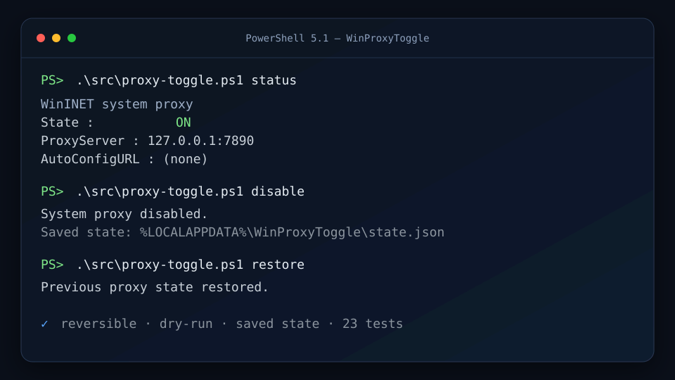

# WinProxyToggle


A small, reversible Windows proxy switch with a PowerShell CLI, a tray icon, saved state, dry-run, and tests.

[中文 README](README.md) · [中文设计说明](docs/design.zh-CN.md)

> This is a local network convenience tool, not a VPN or a way to bypass network policy.
> It changes the current user's WinINET proxy settings and optionally WinHTTP when elevated.

## Why

Switching between a proxy and a direct connection in Windows Settings takes several clicks, and it is easy to forget what was changed. The first version of this tool was a 6-line `.bat` that only did this:

```bat
reg add "HKCU\Software\Microsoft\Windows\CurrentVersion\Internet Settings" /v ProxyEnable /t REG_DWORD /d 0 /f
```

That was enough to turn the manual proxy off, but it had real gaps:

- it could not turn the proxy back on
- it did not remember the previous `ProxyServer`
- it did not handle PAC (`AutoConfigURL`)
- it did not handle WinHTTP
- it reported `[OK]` even if the write failed
- it could not be used safely from another script

This project keeps the small-tool spirit but adds the parts that make it reliable.

## Features

- `status` — shows WinINET, WinHTTP, proxy environment variables, and saved state
- `disable` — saves the current state and turns the system proxy off
- `enable` — turns the system proxy on, restoring the saved server if needed
- `restore` — restores the exact saved state and removes the state file
- `tray` — a tray icon with Disable / Enable / Restore / Exit
- `-DryRun` — shows what would change without writing
- `-Json` — machine-readable output for scripts
- `-IncludeAutoConfig` — also saves and disables PAC (`AutoConfigURL`)
- `-SkipWinHttp` — do not touch WinHTTP (useful when not elevated)
- Tests use an isolated `HKCU` key; they never change your real proxy

## Demo



A full CLI transcript is in [`docs/demo.md`](docs/demo.md). It uses an isolated test key, so it does not change the real system proxy.

```text
PS> .\src\proxy-toggle.ps1 status
WinINET system proxy
  State          : ON
  ProxyServer    : 127.0.0.1:7890
  AutoConfigURL  : (none)
...
PS> .\src\proxy-toggle.ps1 disable
System proxy disabled...
PS> .\src\proxy-toggle.ps1 restore
Previous proxy state restored.
```

## Requirements

- Windows 10 or 11
- Windows PowerShell 5.1 or PowerShell 7+
- No admin required for WinINET-only mode
- Admin required to change WinHTTP

## Quick start

```powershell
# See current state
.\src\proxy-toggle.ps1 status

# Turn the system proxy off, saving the old state
.\src\proxy-toggle.ps1 disable

# Turn it back on
.\src\proxy-toggle.ps1 enable

# Restore the exact state from before "disable"
.\src\proxy-toggle.ps1 restore

# Start the tray icon
.\src\proxy-toggle.ps1 tray
```

Or use the wrappers:

```text
bin\proxy-toggle.cmd status
bin\proxy-toggle-tray.cmd
```

### Dry run

```powershell
.\src\proxy-toggle.ps1 disable -DryRun
.\src\proxy-toggle.ps1 restore -DryRun
```

### JSON output

```powershell
.\src\proxy-toggle.ps1 status -Json
```

### Include PAC

```powershell
.\src\proxy-toggle.ps1 disable -IncludeAutoConfig
```

Without `-IncludeAutoConfig`, a PAC URL is left alone; `ProxyEnable` alone does not disable PAC.

## How it works

```text
proxy-toggle.ps1
  └─ ProxyToggle.psm1
       ├─ WinINET registry (HKCU\...\Internet Settings)
       ├─ WinHTTP (netsh winhttp)
       ├─ saved state JSON (%LOCALAPPDATA%\WinProxyToggle\state.json)
       └─ InternetSetOption refresh
```

The state file stores:

- `ProxyEnable`
- `ProxyServer`
- `ProxyOverride`
- `AutoConfigURL`
- the WinHTTP proxy mode and address
- a timestamp

`restore` writes those values back and removes the state file.

## Tray icon

Start it with:

```powershell
.\src\proxy-toggle.ps1 tray
```

Right-click the tray icon:

- **Disable system proxy**
- **Enable system proxy**
- **Restore previous state**
- **About / open folder**
- **Exit**

Double-click toggles the proxy.

The tray script uses a single-instance mutex, so launching it twice does nothing harmful.

## Tests

```powershell
powershell.exe -NoProfile -ExecutionPolicy Bypass -File .\tests\run-tests.ps1
```

The test suite creates a temporary registry key under:

```text
HKCU\Software\WinProxyToggle\Tests\<guid>
```

and verifies:

- dry-run does not write
- disable saves state and sets `ProxyEnable=0`
- enable restores the saved PAC/server
- restore applies the full original state
- the state file is removed after restore
- a key with only `ProxyEnable` does not throw under `Set-StrictMode`
- formatted status contains the expected sections

Expected result:

```text
Passed: 23  Failed: 0
```

## Limitations

- Does not change application-specific proxies (browser extensions, IDE settings, etc.)
- Does not change `HTTP_PROXY` / `HTTPS_PROXY` environment variables
- WinHTTP changes need an elevated shell; otherwise the tool reports `Skipped (needs administrator)`
- `enable` only turns the manual proxy on; it does not invent a proxy server if none was ever configured
- This is not a security boundary. A local user can change the same settings manually.

## Safety and rollback

- `disable` saves state before writing
- `restore` returns to the saved state
- `-DryRun` previews every write
- Tests use an isolated registry key
- No Windows service, scheduled task, or registry run key is created
- Uninstall: delete the folder and `%LOCALAPPDATA%\WinProxyToggle`

## Project structure

```text
win-proxy-toggle/
  src/
    ProxyToggle.psm1
    proxy-toggle.ps1
    ProxyToggle.Tray.ps1
  bin/
    proxy-toggle.cmd
    proxy-toggle-tray.cmd
  tests/
    run-tests.ps1
  docs/
    case-study.md
    ai-collaboration.md
    design.zh-CN.md
    demo.md
    demo.svg
    icon.svg
    legacy/
      close-proxy.bat
    screenshots/
      README.md
  .github/
    workflows/
      test.yml
  README.md
  README.en.md
  LICENSE
  CHANGELOG.md
  .gitignore
```

## AI-assisted development

This project was built with AI assistance. The useful part was not "generate code"; it was the loop:

1. define the failure modes of the 6-line version
2. research the WinINET / WinHTTP split
3. choose the smallest safe scope (HKCU first, admin-only WinHTTP)
4. generate tests before trusting the implementation
5. find and fix real issues (StrictMode property access, `$args` collision, localized `netsh` output)
6. verify with tests and a dry run

See [`docs/ai-collaboration.md`](docs/ai-collaboration.md) for the concrete record.

## License

MIT. See [LICENSE](LICENSE).
