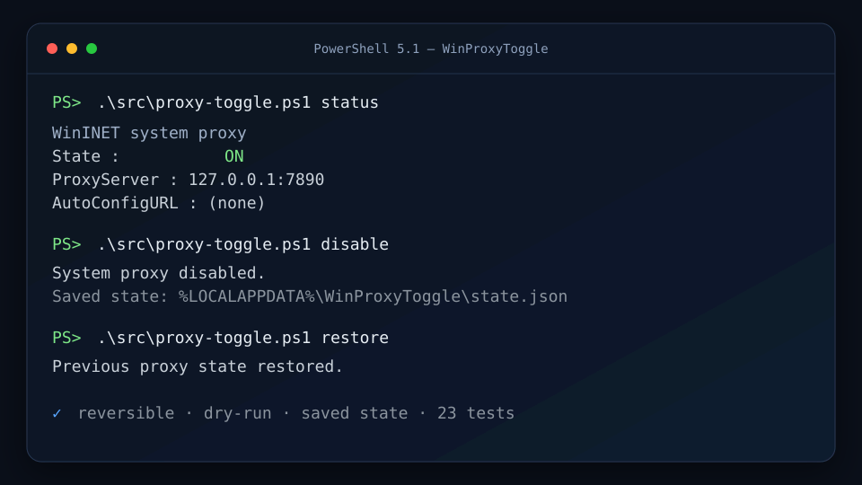

# WinProxyToggle

> 一个法学毕业生的第一个小工具：用 AI 把 6 行 bat 做成一个可回退、可验证的 Windows 系统代理开关。

[English README](README.en.md) · [中文设计说明](docs/design.zh-CN.md)

---

## 先看这里：怎么用

> 不想看代码，只看这一节就够了。

### 第 1 步：打开托盘图标

打开项目里的 `bin` 文件夹，双击：

```text
bin\proxy-toggle-tray.cmd
```

路径根据你解压的位置而定，例如：

```text
D:\tools\win-proxy-toggle\bin\proxy-toggle-tray.cmd
```

如果 Windows 弹出“已保护你的电脑”：

```text
更多信息 → 仍要运行
```

然后看任务栏右下角。  
如果没看到图标，点一下任务栏的 `^`（显示隐藏的图标）。

### 第 2 步：右键托盘图标

右键之后，你会看到这些菜单：

| 你点击的菜单 | 会发生什么 |
|---|---|
| `Disable system proxy` | 先记住当前代理，再关闭系统代理 |
| `Enable system proxy` | 重新打开系统代理 |
| `Restore previous state` | 回到“关闭代理”之前的状态，并删除保存的状态 |
| `About / open folder` | 打开日志文件夹 |
| `Exit` | 关闭托盘图标；不会改变代理设置 |

菜单最上面那一行是状态，不可点击：

- `Proxy: ON (...)`：代理当前是开的
- `Proxy: OFF (direct)`：代理当前是关的，走直连

### 第 3 步：双击图标

双击托盘图标，会在“开”和“关”之间切换。

注意：

- 双击只是快速切换
- 想完整回到以前的状态，要用右键菜单里的 **Restore previous state**

### 第一次建议这样试

1. 右键 → `Disable system proxy`
2. 看 Windows 设置 → 网络和 Internet → 代理，确认已经关闭
3. 右键 → `Restore previous state`
4. 再看一次，确认代理恢复

**先确认“能恢复”，再正常使用。**  
这比“能关闭”更重要。

### 如果你要用命令行

```powershell
cd D:\tools\win-proxy-toggle

.\src\proxy-toggle.ps1 status
.\src\proxy-toggle.ps1 disable
.\src\proxy-toggle.ps1 restore
```

把 `D:\tools\win-proxy-toggle` 换成你实际解压的路径。

对应含义：

| 命令 | 作用 |
|---|---|
| `status` | 看当前状态，不改任何东西 |
| `disable` | 保存状态并关闭代理 |
| `enable` | 打开代理 |
| `restore` | 恢复到关闭前的状态 |

### 管理员权限

- 普通双击：只处理 WinINET，不需要管理员
- 右键 `proxy-toggle-tray.cmd` → **以管理员身份运行**：才能处理 WinHTTP

如果只是日常浏览器代理，普通双击就够了。

---

## 关于我

我是冶明贤，四川大学法学本科。

我的求职方向是法务助理、行政文员、社区调解员、综合管理岗。  
我不是程序员，平时更熟悉法律检索、材料整理、WPS 和 AI 工具。  
我做过法官助理实习，也做过社区法律公益咨询，习惯先核对事实、再给方案。

这个项目是我第一次把一个小小的日常麻烦，完整地做成“有说明、有测试、能回退”的工具。  
代码主要是我和 AI 一起完成的：我负责把问题讲清楚、做取舍、验证结果、写文档；AI 负责查资料、给初版、帮我补测试。

我不是来证明自己已经是程序员的。  
我更想用这个项目说明：**我能用 AI 把一个具体问题推进到一个可用的结果，并且知道哪里该停、哪里该验证、哪里该留后路。**

---

## 1. 我为什么做这个

我经常需要在“系统代理”和“直连”之间切换。

Windows 设置里点来点去很麻烦，而且关掉代理之后，我经常会忘记原来的代理地址是什么。下次想开回来，只能重新找。

一开始我写了一个 6 行 bat：

```bat
@echo off
title Close Proxy
set "key=HKCU\Software\Microsoft\Windows\CurrentVersion\Internet Settings"
reg add "%key%" /v ProxyEnable /t REG_DWORD /d 0 /f >nul
echo [OK] System proxy has been disabled.
pause
```

它确实能关掉代理。

但后来我发现，它的问题比想象中多：

- 只能关，不能开
- 不记得原来的代理地址
- 不处理 PAC（自动代理配置）
- 不处理 WinHTTP（Windows 的另一套代理）
- 写入失败也显示 `[OK]`
- 没有测试，也没有说明

这让我意识到：**“能跑”与“可靠”是两件事。**

---

## 2. 这个工具现在能做什么

| 功能 | 用大白话说 |
|---|---|
| `status` | 看现在代理是开还是关，代理地址是什么 |
| `disable` | 先记住当前状态，再关闭系统代理 |
| `enable` | 重新打开系统代理 |
| `restore` | 回到关闭代理之前的状态，并删除保存的状态 |
| `tray` | 在桌面右下角放一个托盘图标，右键操作 |
| `-DryRun` | 先演练一遍，不真的改 |
| `-Json` | 输出给其他脚本看的格式 |
| `-IncludeAutoConfig` | 连 PAC 一起保存和关闭 |
| `-SkipWinHttp` | 不碰 WinHTTP，不需要管理员权限 |

测试全部使用临时注册表键，**不会碰真实的系统代理**。

---

## 3. 命令行详细用法（可选）

上面的托盘已经够日常使用。下面这些是给“想用命令行 / 想接脚本”的人看的。

### 基本命令

```powershell
.\src\proxy-toggle.ps1 status
.\src\proxy-toggle.ps1 disable
.\src\proxy-toggle.ps1 enable
.\src\proxy-toggle.ps1 restore
.\src\proxy-toggle.ps1 tray
```

### 先演练，不真改

```powershell
.\src\proxy-toggle.ps1 disable -DryRun
.\src\proxy-toggle.ps1 restore -DryRun
```

`-DryRun` 只显示“准备做什么”，不写注册表。

### 看 JSON

```powershell
.\src\proxy-toggle.ps1 status -Json
```

适合给其他脚本读取。

### 连 PAC 一起处理

```powershell
.\src\proxy-toggle.ps1 disable -IncludeAutoConfig
```

不加这个参数时，PAC 不会被改动。

### 不处理 WinHTTP

```powershell
.\src\proxy-toggle.ps1 disable -SkipWinHttp
```

不需要管理员权限，也不会碰 WinHTTP。

---

## 4. 演示



完整命令行演示在 [`docs/demo.md`](docs/demo.md)。  
这个演示使用的是临时测试键，不是真实系统代理。

---

## 5. 设计思路（尽量说人话）

### 5.1 Windows 的代理不止一个开关

我原来以为，代理只有一个“开 / 关”。

后来才知道，至少有三层：

| 层 | 作用 | 这个工具怎么处理 |
|---|---|---|
| WinINET | 浏览器、很多桌面程序用的代理 | 默认处理 |
| WinHTTP | 服务、部分程序用的代理 | 有管理员权限时处理，否则明确提示跳过 |
| PAC | 自动代理配置文件 | 加 `-IncludeAutoConfig` 时处理 |

所以“把 ProxyEnable 改成 0”并不等于“所有地方都不走代理”。

### 5.2 先保存，再修改

`disable` 不是直接改。

它先做一件事：**把当前状态保存到 JSON 文件**。

就像出门前先拍一张房间的照片，回来再按照片恢复。保存的内容包括：

- `ProxyEnable`
- `ProxyServer`
- `ProxyOverride`
- `AutoConfigURL`
- WinHTTP 的代理模式

`restore` 再按这些值写回去，然后删除状态文件。

### 5.3 先演练，再执行

改代理会直接影响网络，所以工具提供 `-DryRun`。

它只告诉你“准备做什么”，不写注册表。  
这和我做法律材料时的习惯很像：**先核对事实和步骤，再正式提交。**

### 5.4 测试在“草稿纸”上做

测试不碰真实代理，而是创建一个临时注册表键：

```text
HKCU\Software\WinProxyToggle\Tests\<guid>
```

就像在草稿纸上验算，确认没问题，再去改正式文件。

---

## 6. 我是怎么把它做出来的

我不是先学完编程再做，而是边做边学。

### 第一步：把问题说清楚

我先列了 6 行 bat 的问题：

- 不能恢复
- 不处理 PAC
- 不处理 WinHTTP
- 不检查失败

这一步很像写法律意见：先把事实和风险列出来，不急着下结论。

### 第二步：让 AI 帮我查资料

我问 AI：

- Windows 的系统代理到底存在哪里？
- WinINET 和 WinHTTP 有什么区别？
- 为什么改了注册表，浏览器有时不生效？
- `netsh winhttp show proxy` 的输出为什么和系统语言有关？

AI 给了我方向，但我会自己再核对，不直接照抄。

### 第三步：先定边界

我决定：

- 默认只改当前用户，不动整台机器
- 不注册 Windows 服务
- 不创建计划任务
- 没有管理员权限时，不假装 WinHTTP 改成功
- 所有写操作都要能 `-DryRun`
- 测试绝对不能碰真实代理

这些边界不是 AI 替我定的，是我根据风险自己定的。

### 第四步：让 AI 写初版，我来验证

AI 帮我生成了 PowerShell 模块、命令行入口、托盘和测试的初版。

我做的是：

- 跑测试
- 看输出对不对
- 改掉不安全的写法
- 发现 AI 漏掉的细节
- 把说明写成别人能看懂的样子

### 第五步：留下可回退的路

最后我加了：

- `restore`
- 状态文件
- `-DryRun`
- 隔离测试
- 失败时的明确提示

因为改系统设置的工具，**“能恢复”比“功能多”重要。**

---

## 7. 我踩过的坑

这部分是我觉得最能说明“不是无脑让 AI 写代码”的地方。

### 坑 1：`$args` 是 PowerShell 的自动变量

我一开始在恢复 WinHTTP 时写了：

```powershell
$args = @('winhttp', 'set', 'proxy', $saved.WinHttp.Proxy)
& netsh @args
```

`$args` 是 PowerShell 自己用的变量，不应该拿来赋值。  
后来改成了 `$netshArgs`。

### 坑 2：StrictMode 下，缺失的属性会报错

注册表里不一定有 `ProxyServer`。  
直接写 `$item.ProxyServer`，在某些情况下会抛错。

后来加了一个安全读取属性的小函数，先判断属性存不存在。

### 坑 3：`ProxyEnable` 必须是 DWORD

`Set-ItemProperty` 不保证注册表值类型。  
代理开关需要 `REG_DWORD`，所以改用 `New-ItemProperty -PropertyType DWord -Force`。

### 坑 4：中文注释和编码

Windows PowerShell 5.1 对“没有 BOM 的 UTF-8”中文支持不好，可能乱码。

所以项目里的 `.ps1` / `.psm1` 全部保存为 **UTF-8 with BOM**，并且用 Windows PowerShell 5.1 实际跑过测试。

### 坑 5：`netsh` 的输出会随系统语言变化

中文系统上，`netsh winhttp show proxy` 的标签是中文。  
所以解析时要同时匹配英文和中文，解析不出来就返回 `Unknown`，不猜。

---

## 8. 测试结果

```text
Passed: 23  Failed: 0
```

在 **Windows PowerShell 5.1** 下实际运行通过。

测试覆盖：

- DryRun 不写入
- disable 保存状态并关闭代理
- disable 按需清除 PAC
- enable 恢复保存的代理地址
- restore 恢复全部原始值
- restore 删除状态文件
- 只有 `ProxyEnable` 的注册表键不报错
- 状态输出包含预期内容

---

## 9. 这个项目体现了我什么能力

| 能力 | 在这个项目里的体现 |
|---|---|
| 法律训练带来的风险意识 | 先想“改坏了怎么恢复”，再想“怎么改” |
| 材料整理 | 把问题、设计、测试、限制写成结构清楚的文档 |
| 数字办公 / AI 应用 | 用 AI 查资料、生成初版、补测试，但不盲信 |
| 沟通 | 把技术问题翻译成非技术读者能看懂的话 |
| 学习能力 | 不是计算机专业，但能边做边学、验证、修正 |
| 合规意识 | 不把工具说成 VPN，不暗示可以绕过网络策略 |

我不是计算机专业，代码也不是我一行一行从零敲出来的。

但我能判断：

- 什么该做，什么不该做
- 哪些结果是可信的，哪些需要验证
- 哪些失败必须让用户看见，不能假装成功
- 怎么把一个技术结果讲清楚

这些能力，和做法务助理、行政文员、社区调解、综合管理，是相通的。

---

## 10. 局限和边界

这个工具**不是**：

- VPN
- 流量转发工具
- 绕过公司/学校网络策略的工具
- 安全边界

它**不处理**：

- 浏览器插件自己的代理
- IDE 自己的代理设置
- `HTTP_PROXY` / `HTTPS_PROXY` 环境变量
- 已经运行的程序的内存状态

WinHTTP 修改需要管理员权限；没有权限时，工具会明确显示“跳过”，不会假装成功。

---

## 11. 文件结构

```text
win-proxy-toggle/
  src/
    ProxyToggle.psm1       核心逻辑
    proxy-toggle.ps1       命令行入口
    ProxyToggle.Tray.ps1   托盘图标
  bin/
    proxy-toggle.cmd       命令行包装
    proxy-toggle-tray.cmd  托盘包装
  tests/
    run-tests.ps1          隔离测试
  docs/
    design.zh-CN.md        中文设计说明
    case-study.md          英文案例复盘
    ai-collaboration.md    英文 AI 协作记录
    demo.md / demo.svg     演示
    legacy/
      close-proxy.bat      最早的 6 行版本，仅作对比
    screenshots/           截图/GIF 放这里
  README.md                本文件
  README.en.md             英文版
  LICENSE
  CHANGELOG.md
  .gitignore
```

---

## 12. AI 协作说明

这个项目是 AI 辅助完成的。

AI 做了：

- 解释 WinINET / WinHTTP / PAC
- 生成模块、CLI、托盘和测试的初版
- 帮我找一些 PowerShell 的坑

我做了：

- 定义问题和范围
- 决定只改 HKCU、不碰 HKLM
- 决定不注册服务、不创建计划任务
- 决定测试必须使用隔离注册表键
- 验证测试结果
- 发现并修正问题
- 写中文说明和风险边界

如果你是企业面试官，我更希望你看的是：

> 我不是“让 AI 写完就交”，而是知道怎么定义问题、验证结果、控制风险。

更细的协作记录在 [`docs/ai-collaboration.md`](docs/ai-collaboration.md)（英文），中文设计说明里也有对应章节。

---

## 13. 运行环境

- Windows 10 / 11
- Windows PowerShell 5.1 或 PowerShell 7+
- WinINET 模式不需要管理员
- WinHTTP 模式需要管理员

---

## 14. 许可

MIT License。见 [LICENSE](LICENSE)。

---

## 15. 给同样不是程序员的人

如果你也在用 AI 做一个小工具，我的建议是：

1. 先把问题写成一句话
2. 再写“它不能做什么”
3. 先设计怎么恢复，再设计怎么修改
4. 让 AI 给初版，但自己跑一遍
5. 把测试和限制写进 README

代码可以慢慢学，**但风险意识和验证习惯，可以先有。**
